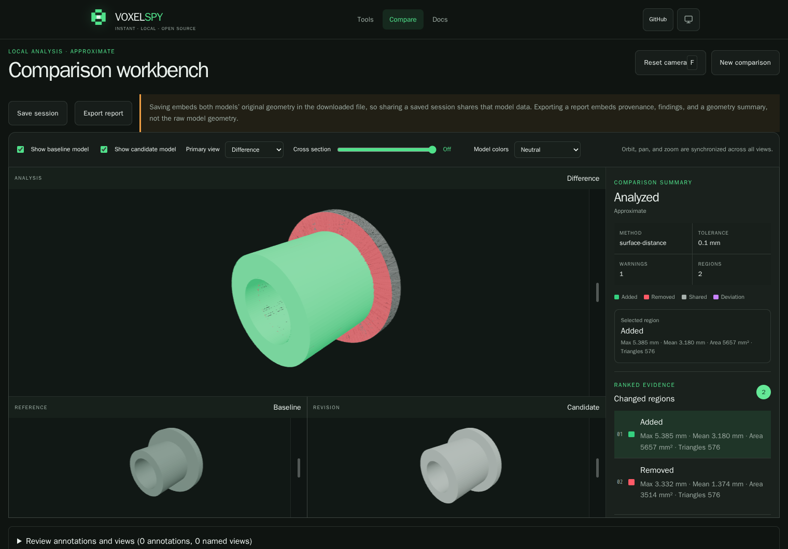
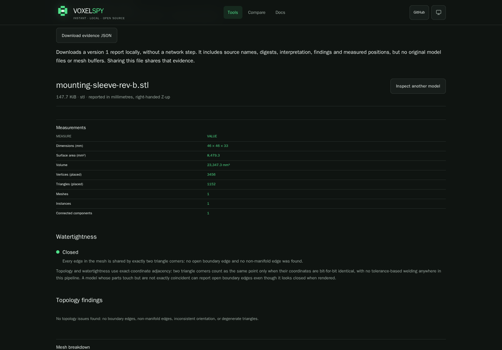

# VoxelSpy

VoxelSpy is a free, open-source toolkit for understanding, validating, measuring, and comparing 3D geometry. It is local-first: models are read and analysed in your own browser, and nothing is uploaded to run a comparison.

The browser application is a set of tools rather than a single one. Compare two revisions and see what changed; inspect one model's dimensions, volume, topology, and provenance; measure distances and cut sections; check whether two positioned parts fit; read what a file actually contains and what the importer refused; gather printability evidence; and convert or simplify with the deviation measured rather than asserted. A headless command line runs the same engines for automation, and the analysis and framework packages expose them to other applications.



**Start here:** [usage guide](docs/USAGE.md) · [CLI guide](apps/cli/README.md) ·
[format support](packages/importers/README.md) · [self-hosted suite](https://github.com/SyrSyn/voxelspy-pdm)

## Try it locally

With Docker and Compose installed, clone this repository and run:

```sh
git clone https://github.com/SyrSyn/voxelspy.git
cd voxelspy
docker compose -f compose.example.yaml up --build -d
```

Open <http://localhost:8080>, choose **Tools**, and load a model. The first build
downloads dependencies; subsequent use processes geometry in your browser.
This loopback-only example serves the independent free tools with the shipped
security policies. It needs no account, database or PDM installation.
[Source setup and first workflows](docs/USAGE.md) cover development, reports,
sessions, CLI use and stopping the container.

## What can I do with it?

| Start with a question                        | Use                                                                                           |
| -------------------------------------------- | --------------------------------------------------------------------------------------------- |
| What changed between these revisions?        | **Compare**: synchronized views, ranked changes, callouts, saved views and portable sessions. |
| What are its dimensions and mesh properties? | **Inspect**: bounds, qualified volume, topology and import provenance.                        |
| Are there crossing triangles?                | **Mesh Health**: located self-intersection evidence.                                          |
| What is this distance or section?            | **Measure & Section**: interactive measurements and section evidence.                         |
| How close are these positioned parts?        | **Clearance & Fit**: sampled distance and separate intersection findings.                     |
| What should I check before printing?         | **Printability**: build-volume and orientation evidence.                                      |
| What did the importer accept or reject?      | **File Forensics**: format declarations, warnings and limits.                                 |
| Can I convert or simplify this mesh?         | **Convert**: explicit output frame, preview and measured deviation.                           |



[Download the example models](docs/examples/README.md) to reproduce these views.

Inputs include bounded STL, OBJ, glTF/GLB, 3MF and STEP subsets. Export evidence
locally and choose what you share. The separate self-hosted PDM suite adds
private projects, immutable revisions, review history, comments and saved
artifacts around these same tools; repository access depends on its visibility.

**Status: pre-release, for evaluation.** Integrated local workflows and
same-version restore have been exercised; facility-wide production acceptance,
physical-device qualification and off-host disaster recovery remain open.
STEP becomes tessellated geometry, and sampled comparisons do not certify fit,
manufacturing equivalence or tolerance compliance. See [current inventory](INVENTORY.md),
[method limits](packages/analysis/README.md) and historical
[release evidence](RELEASE-EVIDENCE.md).

## Direction

VoxelSpy is being designed around three layers:

- A zero-install web inspector for STL, 3MF, OBJ, glTF/GLB, and STEP files.
- Reusable TypeScript packages and headless tooling for application and CI integrations.
- A self-hosted private project workspace that integrates the same eight tools, with local qualification.

The browser tool normalizes input into an explicit engineering coordinate system, keeps source and user transforms auditable, runs heavy analysis outside the UI thread, and distinguishes exact, approximate, and indeterminate results. The initial workflow centers on synchronized old, new, and diff views with ranked change regions, compact measurements, saved views, markups, reports, and portable sessions.

## Repository status

This repository contains the public project foundation and the accepted version 1 data boundaries for geometry, import, analysis, review reports, portable sessions, worker transport, adapter evidence, and release gates. These contracts are an implementation baseline inside the repository; the package remains private and unpublished, and its `0.1.0` version is not an independent stability promise.

The static browser application currently imports bounded ASCII or binary STL, a documented OBJ subset, static glTF and GLB mesh geometry, 3MF Core geometry, and bounded STEP tessellation. Its eight tools cover comparison, inspection, measurement and sections, clearance and fit, printability evidence, file forensics, conversion with optional simplification and preview, and separate self-intersection evidence in Mesh Health. See [INVENTORY.md](INVENTORY.md) for the current capability map, missing features, and prioritized follow-up work.

Formats that declare nothing about their frame start in millimetres and right-handed Z-up with alternate interpretations available as expert settings, while formats that declare their own unit or axis resolve it from the file and still allow an override. Comparison normalizes into the canonical frame, runs approximate sampled surface-distance analysis in a dedicated browser worker, and opens synchronized difference, baseline, and candidate views. Added and removed findings highlight the actual analyzed surface triangles. A running comparison can be cancelled, and the analysis allowance starts from a recommendation derived from reported device capability that the operator can always override within its bounds. Import provenance, warnings, method semantics, and uncertainty remain visible in the result, including the numeric sample-spacing bound that states what the sampling density could have missed.

A completed comparison can be exported as one self-contained report document, or saved as a portable session archive that embeds both sources and reopens without re-running analysis. Both are explicit local downloads; a saved session carries model geometry, so sharing one transfers model data. Callouts, distance markups and named review views are retained with source-bound references. Other tools offer versioned evidence JSON downloads. The self-hosted team/PDM suite reuses these tools with exact project revisions, immutable saved artifacts and session reopening. Its identity and persistence boundary remains separate; it is not required by this browser toolkit. See [the local suite scope](PDM-PLAN.md).

Implementation ceilings are fail-closed safety bounds, not general model-size or production-readiness claims. See the web, importer, and analysis package READMEs for the exact supported subsets and method limits.

The workspace layout is:

```text
apps/       User-facing applications
packages/   Reusable runtime and UI packages
spikes/     Time-bounded technical evidence
```

## Development

Requirements:

- Node.js 24 or newer
- Corepack

```sh
corepack enable
pnpm install --frozen-lockfile
pnpm check
```

Run the web application locally with:

```sh
pnpm exec turbo run build --filter=@voxelspy/web
pnpm --filter @voxelspy/web dev
```

Package-specific checks and limits are documented in the READMEs under `apps/` and `packages/`. See [CONTRIBUTING.md](CONTRIBUTING.md) for contribution and verification expectations.

## Privacy and security

The implemented comparison path reads source files, imports geometry, and runs analysis locally in the browser without a model API, hosted identity, storage, or telemetry. Network behavior and third-party assets must remain explicit and auditable. An automated audit exercises every route and the full workflow, including export, session save, and reopen, and fails if any request or attempted request leaves the origin; the build ships a content security policy without inline-script or inline-style allowances on application pages and refuses to complete if that policy is dropped. STEP uses a separate same-origin kernel worker with a narrowly scoped evaluation policy; application pages keep their stricter policy. Kernel assets, license notices and matching source archives ship with the static build. Enforcement of those headers depends on the host serving them. This local boundary does not make the pre-release software production-ready. See [PRIVACY.md](PRIVACY.md) and [SECURITY.md](SECURITY.md).

## License

VoxelSpy is available under the [MIT License](LICENSE). Geometry fixtures and third-party components may carry their own compatible licenses and provenance records.
